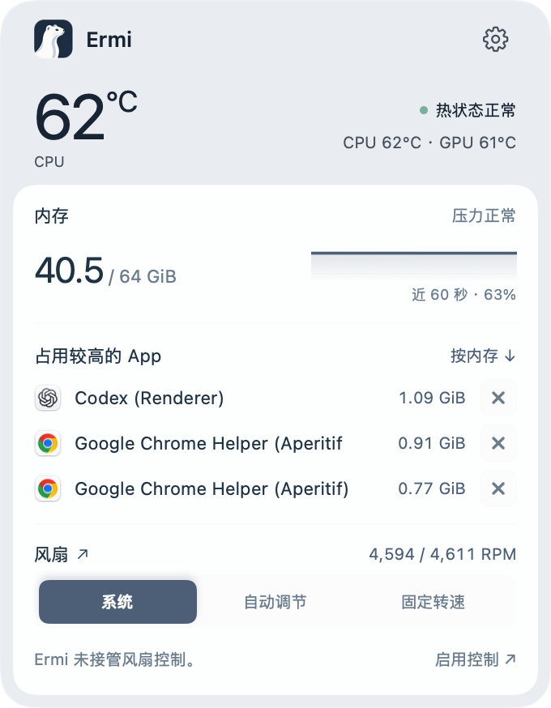
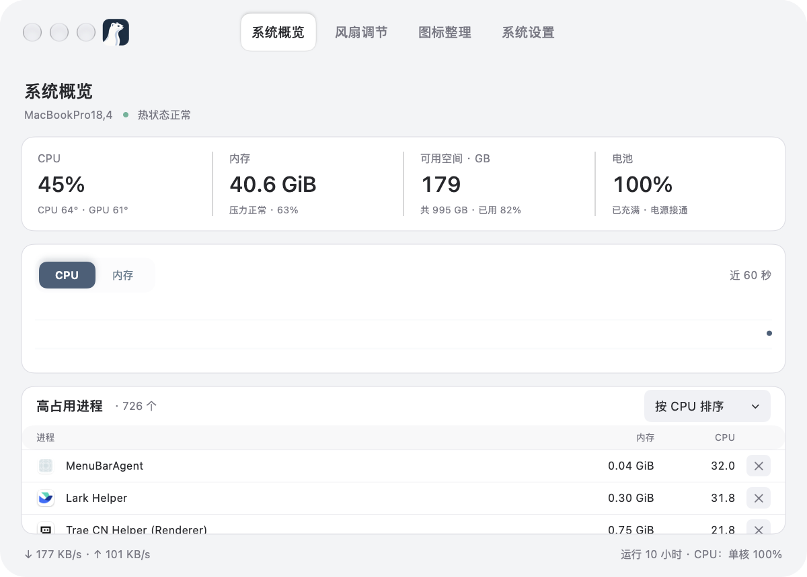

<h1 align="center">Ermi</h1>
<p align="center">随时了解 Mac 状态，调节散热，整理菜单栏。</p>
<p align="center"><a href="https://github.com/lay215/Ermi/releases">下载 / Releases</a> · macOS 14+ · Intel / Apple Silicon · <a href="LICENSE">MIT</a></p>
<p align="center"><a href="README.md">English</a> · 简体中文</p>

Ermi 是一款开源的原生 macOS 菜单栏工具，集系统监控、风扇调节与图标整理于一体，使用 SwiftUI + AppKit 构建。

## 界面预览

<p align="center"></p>
<p align="center">菜单栏弹窗</p>

| 系统概览 | 风扇调节 | 图标整理 |
| --- | --- | --- |
|  |  |  |

截图由 v0.1.3 应用读取本机真实数据后导出，数值和权限状态均为截图时状态。

## 功能

- **系统监控**：查看 CPU、内存、近期趋势、内存压力、磁盘空间、电池、网络流量、运行时间和进程。
- **温度与转速**：在支持的硬件上读取 CPU/GPU 温度和风扇 RPM；无法读取时明确显示未知。
- **风扇调节**：支持系统管理、固定转速、两点自动温控及内置和自定义方案；启动或唤醒后尝试恢复上次成功应用的配置。
- **温控来源选择**：内置方案可选择 CPU、GPU、两者最高值或具体 SMC 传感器；弹窗主温度同步所选来源，读数缺失时不会静默切换到其他传感器。
- **图标整理**：支持保留、收起、隐藏三组；单击菜单栏箭头即可展开或收起下方紧凑原生浮层，首次点击自动准备清单，访问收起组的原菜单入口。隐藏组应用收纳后不在菜单栏或展开栏显示，可在设置中移回。
- **图标排序**：macOS 27 分组设置与展开栏共享各菜单入口的拖动顺序；跨组使用「移动整个 App」。点击「同步菜单栏顺序」调整当前系统菜单栏，读取实际位置确认后恢复此前收纳状态；系统固定入口不参与排序。
- **个性化**：六种内置配色、自定义颜色，支持简体中文、繁体中文和英文。
- **原生体验**：可选登录启动、减少动态效果，以及四页详情快捷键。

## 下载与安装

**[前往 GitHub Releases 下载 →](https://github.com/lay215/Ermi/releases)**

| 平台 | 安装包 | 状态 |
| --- | --- | --- |
| macOS 14+，Intel 与 Apple Silicon | [Ermi-0.1.3-universal-preview.dmg](https://github.com/lay215/Ermi/releases/download/v0.1.3/Ermi-0.1.3-universal-preview.dmg) | 预览版，主要在 M1 Max 上验证 |

1. 打开 Releases，阅读该版本的兼容性说明。
2. 下载并打开 `.dmg`，将 **Ermi.app** 拖入 **Applications（应用程序）**。
3. 启动 Ermi，点击菜单栏中的白鼬图标。

预览版采用本机签名，**尚未经过 Apple 公证**。首次打开可能被 macOS 拦截；确认下载来源可信后，可在系统提供该选项时通过“隐私与安全性 → 仍要打开”放行，无需全局关闭 Gatekeeper。

首次使用风扇调节时，选择“安装 / 更新授权”，完成 macOS 管理员验证。安装只建立授权，不会应用风扇方案。图标整理所需权限独立于风扇授权，按系统提示开启。

升级后请到 **系统设置 → 权限与服务 → 安装 / 更新授权** 更新风扇 helper。具体传感器温控需要新版 helper；含新来源的预设可能无法由旧版程序读取。

已知限制：M4 Pro CPU 温度映射偏低问题仍未修复；本版增加具体传感器选择，不代表修正默认映射。读数不可靠时请使用系统风扇控制。

安装包附带 `.sha256` 校验文件，在下载目录执行：

```sh
shasum -a 256 -c Ermi-0.1.3-universal-preview.dmg.sha256
```

## 从源码运行

需要 Intel 或 Apple Silicon Mac、macOS 14+、带 Swift 6 的 Xcode，以及用于本机签名配置的 Python 3 和 OpenSSL。构建脚本生成包含 arm64 与 x86_64 的 Universal App 和 helper。

```sh
git clone https://github.com/lay215/Ermi.git
cd Ermi
python3 scripts/setup-local-signing.py
scripts/build-app.sh
open output/native/Ermi.app
```

签名脚本会在钥匙串中创建或复用固定本机身份，私钥不会进入仓库或安装包。需要使用其他签名身份时，可在构建时指定 `ERMI_SIGNING_IDENTITY`。

```sh
swift test
output/native/Ermi.app/Contents/MacOS/Ermi --smoke-test
scripts/package-dmg.sh
```

构建产物、调试截图与录屏由 Git 忽略；安装包通过 Releases 分发。

## 兼容性与当前限制

- 当前源码按芯片族提供温度映射，按实际能力适配 Intel 与 Apple Silicon 风扇协议，支持单风扇和多风扇；无风扇设备保留监测，未知协议只读。范围、来源和验证限制见[硬件兼容说明](docs/architecture/hardware-compatibility.md)。真机验证仍主要在 **M1 Max**，代码覆盖不等于所有机型已经实测。
- 图标整理依赖系统版本及权限。macOS 27 路径使用实验性私有接口，macOS 14–26 的分隔线方案仍需实机验收。
- 第三方菜单完整交互、真实睡眠唤醒后的风扇恢复仍需更广泛验收；自动化测试通过不代表所有硬件兼容。
- 暂无自动更新或 Apple 公证发行包。

## 文档与反馈

- [版本说明](docs/releases/v0.1.3.md)
- [本机签名与风扇授权](docs/architecture/local-signing-and-gui-install-2026-10-17.md)
- [风扇控制验证记录](docs/architecture/fan-control-validation-2026-10-16.md)
- [反馈问题或建议](https://github.com/lay215/Ermi/issues)

反馈时请附上 Mac 型号、macOS 版本、Ermi 版本和复现步骤。欢迎贡献代码；提交时请运行相关测试，并说明实际做过的硬件验证。

## 开源许可

采用 [MIT License](LICENSE)。第三方参考内容保留原有声明，包括 [Hidden Bar 的 MIT 许可](docs/research/hidden-bar-LICENSE)。
